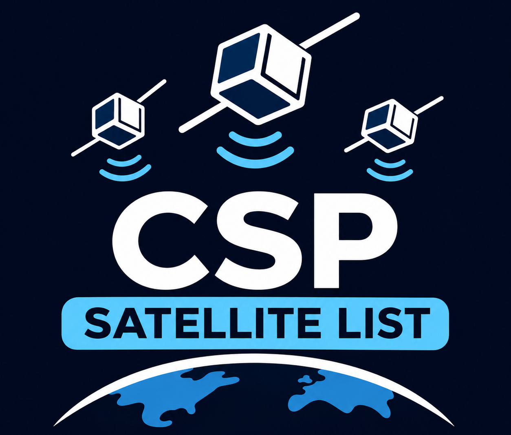

<h1 align="center">Satellites using CubeSat Space Protocol</h1>

  

A source-backed list of satellites with documented or possible use of [CubeSat Space Protocol (CSP)](https://github.com/libcsp/libcsp).

**Last reviewed: 13 November 2026.** The list contains 146 unique spacecraft: 3 with explicit CSP documentation and 143 candidates requiring further confirmation. It includes historical missions and does not track operational status.

## CSV dataset

Download [csp-satellites.csv](csp-satellites.csv) for use in spreadsheets, scripts, or data analysis. It contains the same 146 spacecraft as the tables below, with one spacecraft per row, a header row, UTF-8 encoding, and comma-separated fields.

| Column | Description |
|---|---|
| `satellite_name` | Spacecraft name, including listed aliases. |
| `documentation_url` | Mission documentation or catalog record. |
| `evidence_type` | `direct`, `indirect_radio`, `indirect_supplier`, or `unverified`. |
| `evidence_summary` | What the linked evidence establishes. |
| `evidence_url` | Source supporting the evidence summary. |
| `transceiver` | Documented transceiver model, when established. |
| `radio_mode` | Listed radio framing, when recorded. |
| `notes` | Evidence limitations or information still needed. |
| `last_reviewed` | Source review date in `YYYY-MM-DD` format. |

Empty fields mean the information is not established or recorded. Filter `evidence_type` to `direct` for entries with explicit CSP documentation. Please update the CSV and README together when changing an entry.

## Reading the list

- **Direct:** mission documentation explicitly identifies CSP.
- **Indirect — radio:** a satellite record lists an AX100-family radio mode. This suggests a CSP connection but does not establish the installed transceiver or onboard network.
- **Indirect — supplier:** a source identifies a GomSpace platform or component. A supplier relationship alone does not establish CSP use.
- **Unverified:** the reviewed sources do not substantiate the original CSP claim.

Satellite names link to mission documentation or a catalog record. Evidence links support the specific statement in that row. “Not established” means the reviewed sources do not establish the information, rather than that the satellite does not use CSP.

## Documented CSP use

| Satellite | Evidence | Transceiver |
|---|---|---|
| [PIXL-1][pixl] | [DLR reports successful commanding over CSP][pixlcsp]. | Not established |
| [GOMX-1][gomx] | [Mission design paper, p. 4][gomx], describes CSP across the subsystems and space-to-ground link. | Not established |
| [GreenCube (IO-117)][green] | [Mission-team decoding guide][greencsp] identifies CSP packets and the radio. | GomSpace AX100 |

## Candidates: radio evidence

GomSpace's [AX100 documentation][ax100] identifies CSP support. The records below list **AX.100 Mode 5** framing; that is indirect evidence, not a confirmed hardware inventory or an explicit mission CSP statement. Listings may be inferred or unconfirmed; consult each record's transmitter citations.

| Satellite / catalog record | Radio evidence | CSP assessment |
|---|---|---|
| [GALASSIA-2](https://db.satnogs.org/satellite/BYRQ-8084-9850-7997-7193/) | [AX.100 Mode 5 listing](https://db.satnogs.org/satellite/BYRQ-8084-9850-7997-7193/#transmitters) | Indirect |
| [BRO-13](https://db.satnogs.org/satellite/KSFC-2018-1319-4536-1314/) | [AX.100 Mode 5 listing](https://db.satnogs.org/satellite/KSFC-2018-1319-4536-1314/#transmitters) | Indirect |
| [KSM1-A](https://db.satnogs.org/satellite/HUNW-6973-2030-4958-5201/) | [AX.100 Mode 5 listing](https://db.satnogs.org/satellite/HUNW-6973-2030-4958-5201/#transmitters) | Indirect |
| [ERMIS-3](https://db.satnogs.org/satellite/ZRPV-6317-0836-0013-3209/) | [AX.100 Mode 5 listing](https://db.satnogs.org/satellite/ZRPV-6317-0836-0013-3209/#transmitters) | Indirect |
| [ION SCV Daring Diego](https://db.satnogs.org/satellite/BZWJ-9712-5590-5046-8513/) | [AX.100 Mode 5 listing](https://db.satnogs.org/satellite/BZWJ-9712-5590-5046-8513/#transmitters) | Indirect |
| [BRO-22](https://db.satnogs.org/satellite/98304/) | [AX.100 Mode 5 listing](https://db.satnogs.org/satellite/98304/#transmitters) | Indirect |
| [KINEIS-1A](https://db.satnogs.org/satellite/HPAR-8709-5177-4142-4273/) | [AX.100 Mode 5 listing](https://db.satnogs.org/satellite/HPAR-8709-5177-4142-4273/#transmitters) | Indirect |
| [ION SCV-004](https://db.satnogs.org/satellite/EAHI-9090-2555-3685-8378/) | [AX.100 Mode 5 listing](https://db.satnogs.org/satellite/EAHI-9090-2555-3685-8378/#transmitters) | Indirect; listing cites earlier missions |
| [NUSHSat1](https://db.satnogs.org/satellite/AGMX-2508-1337-4945-9939/) | [AX.100 Mode 5 listing](https://db.satnogs.org/satellite/AGMX-2508-1337-4945-9939/#transmitters) | Indirect |
| [ION SCV Marvelous Mathias](https://db.satnogs.org/satellite/EZAU-8235-2008-4656-9477/) | [AX.100 Mode 5 listing](https://db.satnogs.org/satellite/EZAU-8235-2008-4656-9477/#transmitters) | Indirect |
| [NuLink-2](https://db.satnogs.org/satellite/REYA-7757-1619-4009-9971/) | [AX.100 Mode 5 listing](https://db.satnogs.org/satellite/REYA-7757-1619-4009-9971/#transmitters) | Indirect |
| [ION SCV Astounding Alexandra](https://db.satnogs.org/satellite/IVCW-8630-3606-0296-9103/) | [AX.100 Mode 5 listing](https://db.satnogs.org/satellite/IVCW-8630-3606-0296-9103/#transmitters) | Indirect |
| [BRO-21](https://db.satnogs.org/satellite/EPSO-2740-8746-3078-9656/) | [AX.100 Mode 5 listing](https://db.satnogs.org/satellite/EPSO-2740-8746-3078-9656/#transmitters) | Indirect |
| [AISTECHSAT-2](https://db.satnogs.org/satellite/MSIH-7029-5546-1995-2723/) | [AX.100 Mode 5 listing](https://db.satnogs.org/satellite/MSIH-7029-5546-1995-2723/#transmitters) | Indirect |
| [BRO-6](https://db.satnogs.org/satellite/FIRA-5450-5372-6155-3095/) | [AX.100 Mode 5 listing](https://db.satnogs.org/satellite/FIRA-5450-5372-6155-3095/#transmitters) | Indirect |
| [BRO-18](https://db.satnogs.org/satellite/ENLC-4952-6681-1812-8294/) | [AX.100 Mode 5 listing](https://db.satnogs.org/satellite/ENLC-4952-6681-1812-8294/#transmitters) | Indirect |
| [BRO-19](https://db.satnogs.org/satellite/ZLVU-1189-2777-4843-4951/) | [AX.100 Mode 5 listing](https://db.satnogs.org/satellite/ZLVU-1189-2777-4843-4951/#transmitters) | Indirect |
| [ALAINSAT-1](https://db.satnogs.org/satellite/JRPK-1739-9766-4189-3079/) | [AX.100 Mode 5 listing](https://db.satnogs.org/satellite/JRPK-1739-9766-4189-3079/#transmitters) | Indirect |
| [LUR-1](https://db.satnogs.org/satellite/HMLT-0173-5504-1396-8170/) | [AX.100 Mode 5 listing](https://db.satnogs.org/satellite/HMLT-0173-5504-1396-8170/#transmitters) | Indirect |
| [ION SCV Passionate Paula](https://db.satnogs.org/satellite/JLJE-0670-3801-0857-8118/) | [AX.100 Mode 5 listing](https://db.satnogs.org/satellite/JLJE-0670-3801-0857-8118/#transmitters) | Indirect |
| [VELOX-AM](https://db.satnogs.org/satellite/BVGM-7941-1194-7387-5450/) | [AX.100 Mode 5 listing](https://db.satnogs.org/satellite/BVGM-7941-1194-7387-5450/#transmitters) | Indirect |
| [BRO-5](https://db.satnogs.org/satellite/EAPL-5646-6568-7428-1685/) | [AX.100 Mode 5 listing](https://db.satnogs.org/satellite/EAPL-5646-6568-7428-1685/#transmitters) | Indirect |
| [BRO-11](https://db.satnogs.org/satellite/BKIY-3032-2869-4485-1697/) | [AX.100 Mode 5 listing](https://db.satnogs.org/satellite/BKIY-3032-2869-4485-1697/#transmitters) | Indirect |
| [SATURNIN-1](https://db.satnogs.org/satellite/ZRUJ-5863-3206-3578-5209/) | [AX.100 Mode 5 listing](https://db.satnogs.org/satellite/ZRUJ-5863-3206-3578-5209/#transmitters) | Indirect |
| [BEE-1000](https://db.satnogs.org/satellite/FUNJ-2834-4382-2735-5337/) | [AX.100 Mode 5 listing](https://db.satnogs.org/satellite/FUNJ-2834-4382-2735-5337/#transmitters) | Indirect |
| [ION SCV-014](https://db.satnogs.org/satellite/JVIJ-4226-9631-1978-7970/) | [AX.100 Mode 5 listing](https://db.satnogs.org/satellite/JVIJ-4226-9631-1978-7970/#transmitters) | Indirect |
| [DUTHSat-2](https://db.satnogs.org/satellite/HWSK-3928-3901-7383-3031/) | [AX.100 Mode 5 listing](https://db.satnogs.org/satellite/HWSK-3928-3901-7383-3031/#transmitters) | Indirect |
| [BRO-14](https://db.satnogs.org/satellite/ZTUR-8052-1950-5911-7314/) | [AX.100 Mode 5 listing](https://db.satnogs.org/satellite/ZTUR-8052-1950-5911-7314/#transmitters) | Indirect |
| [ION SCV-016](https://db.satnogs.org/satellite/TNCA-2269-1089-8167-2586/) | [AX.100 Mode 5 listing](https://db.satnogs.org/satellite/TNCA-2269-1089-8167-2586/#transmitters) | Indirect |
| [SNIPE B](https://db.satnogs.org/satellite/KZDM-2447-6592-4881-9320/) | [AX.100 Mode 5 listing](https://db.satnogs.org/satellite/KZDM-2447-6592-4881-9320/#transmitters) | Indirect |
| [BRO-16](https://db.satnogs.org/satellite/HMRN-7466-8969-6530-1296/) | [AX.100 Mode 5 listing](https://db.satnogs.org/satellite/HMRN-7466-8969-6530-1296/#transmitters) | Indirect |
| [BRO-8](https://db.satnogs.org/satellite/RJCF-5779-9216-5641-4111/) | [AX.100 Mode 5 listing](https://db.satnogs.org/satellite/RJCF-5779-9216-5641-4111/#transmitters) | Indirect |
| [ION SCV Charismatic Carlus](https://db.satnogs.org/satellite/MJWC-6105-7146-5103-2066/) | [AX.100 Mode 5 listing](https://db.satnogs.org/satellite/MJWC-6105-7146-5103-2066/#transmitters) | Indirect |
| [SNIPE C](https://db.satnogs.org/satellite/ZNAY-2858-6600-3535-8759/) | [AX.100 Mode 5 listing](https://db.satnogs.org/satellite/ZNAY-2858-6600-3535-8759/#transmitters) | Indirect |
| [K-HERO](https://db.satnogs.org/satellite/VFAW-1957-0148-9612-7991/) | [AX.100 Mode 5 listing](https://db.satnogs.org/satellite/VFAW-1957-0148-9612-7991/#transmitters) | Indirect |
| [THEA](https://db.satnogs.org/satellite/OSTA-3937-9747-5420-7898/) | [AX.100 Mode 5 listing](https://db.satnogs.org/satellite/OSTA-3937-9747-5420-7898/#transmitters) | Indirect |
| [SNIPE D](https://db.satnogs.org/satellite/EOVQ-9559-0511-0103-2591/) | [AX.100 Mode 5 listing](https://db.satnogs.org/satellite/EOVQ-9559-0511-0103-2591/#transmitters) | Indirect |
| [SNIPE A](https://db.satnogs.org/satellite/AYLO-6910-6407-3496-4588/) | [AX.100 Mode 5 listing](https://db.satnogs.org/satellite/AYLO-6910-6407-3496-4588/#transmitters) | Indirect |
| [FrontierSat](https://db.satnogs.org/satellite/GGCH-4346-1583-9419-5634/) | [AX.100 Mode 5 listing](https://db.satnogs.org/satellite/GGCH-4346-1583-9419-5634/#transmitters) | Indirect |
| [BRO-12](https://db.satnogs.org/satellite/IQOY-7969-6018-3429-4654/) | [AX.100 Mode 5 listing](https://db.satnogs.org/satellite/IQOY-7969-6018-3429-4654/#transmitters) | Indirect |
| [BRO-15](https://db.satnogs.org/satellite/PUFM-6212-8243-7442-9645/) | [AX.100 Mode 5 listing](https://db.satnogs.org/satellite/PUFM-6212-8243-7442-9645/#transmitters) | Indirect |
| [TY-41](https://db.satnogs.org/satellite/FOYC-0465-3890-7368-7165/) | [AX.100 Mode 5 listing](https://db.satnogs.org/satellite/FOYC-0465-3890-7368-7165/#transmitters) | Indirect |
| [UND ROADS 2](https://db.satnogs.org/satellite/BZMH-1691-0385-6822-7921/) | [AX.100 Mode 5 listing](https://db.satnogs.org/satellite/BZMH-1691-0385-6822-7921/#transmitters) | Indirect |
| [ION SCV-007](https://db.satnogs.org/satellite/VPUU-7194-1121-2414-5647/) | [AX.100 Mode 5 listing](https://db.satnogs.org/satellite/VPUU-7194-1121-2414-5647/#transmitters) | Indirect |
| [CatSat](https://db.satnogs.org/satellite/EIOW-0233-5270-5407-2865/) | [AX.100 Mode 5 listing](https://db.satnogs.org/satellite/EIOW-0233-5270-5407-2865/#transmitters) | Indirect |
| [UND ROADS 1](https://db.satnogs.org/satellite/CGQM-1404-3051-5125-7571/) | [AX.100 Mode 5 listing](https://db.satnogs.org/satellite/CGQM-1404-3051-5125-7571/#transmitters) | Indirect |
| [KSM1-C](https://db.satnogs.org/satellite/ZQAV-4893-1919-8347-2035/) | [AX.100 Mode 5 listing](https://db.satnogs.org/satellite/ZQAV-4893-1919-8347-2035/#transmitters) | Indirect |
| [ION SCV Joyful Julia](https://db.satnogs.org/satellite/QGYT-6411-9788-7098-8379/) | [AX.100 Mode 5 listing](https://db.satnogs.org/satellite/QGYT-6411-9788-7098-8379/#transmitters) | Indirect |
| [BRO-10](https://db.satnogs.org/satellite/BISO-5259-3723-1730-8460/) | [AX.100 Mode 5 listing](https://db.satnogs.org/satellite/BISO-5259-3723-1730-8460/#transmitters) | Indirect |
| [ERNST](https://db.satnogs.org/satellite/OZFM-4525-5507-9609-6820/) | [AX.100 Mode 5 listing](https://db.satnogs.org/satellite/OZFM-4525-5507-9609-6820/#transmitters) | Indirect |
| [CoRAL](https://db.satnogs.org/satellite/PBKS-8836-3208-9942-5973/) | [AX.100 Mode 5 listing](https://db.satnogs.org/satellite/PBKS-8836-3208-9942-5973/#transmitters) | Indirect |
| [UM5Sat-Ribat](https://db.satnogs.org/satellite/QRWE-3933-7174-7805-6481/) | [AX.100 Mode 5 listing](https://db.satnogs.org/satellite/QRWE-3933-7174-7805-6481/#transmitters) | Indirect |
| [ION SCV-006](https://db.satnogs.org/satellite/TQIP-5428-9682-2220-6430/) | [AX.100 Mode 5 listing](https://db.satnogs.org/satellite/TQIP-5428-9682-2220-6430/#transmitters) | Indirect |
| [ION SCV-012](https://db.satnogs.org/satellite/LWDE-7403-4643-6587-2546/) | [AX.100 Mode 5 listing](https://db.satnogs.org/satellite/LWDE-7403-4643-6587-2546/#transmitters) | Indirect |
| [ERMIS-2](https://db.satnogs.org/satellite/EALZ-0780-6325-0069-2307/) | [AX.100 Mode 5 listing](https://db.satnogs.org/satellite/EALZ-0780-6325-0069-2307/#transmitters) | Indirect |
| [BRO-31](https://db.satnogs.org/satellite/98286/) | [AX.100 Mode 5 listing](https://db.satnogs.org/satellite/98286/#transmitters) | Indirect; radio listing unconfirmed |
| [KINEIS-1E](https://db.satnogs.org/satellite/LCDF-7727-1999-3080-1795/) | [AX.100 Mode 5 listing](https://db.satnogs.org/satellite/LCDF-7727-1999-3080-1795/#transmitters) | Indirect |
| [NuLink-1](https://db.satnogs.org/satellite/YEEE-7340-7726-4018-8919/) | [AX.100 Mode 5 listing](https://db.satnogs.org/satellite/YEEE-7340-7726-4018-8919/#transmitters) | Indirect |
| [KSM1-B](https://db.satnogs.org/satellite/MWRL-6562-0983-3996-2101/) | [AX.100 Mode 5 listing](https://db.satnogs.org/satellite/MWRL-6562-0983-3996-2101/#transmitters) | Indirect |
| [MIMAN](https://db.satnogs.org/satellite/AOTT-8678-9365-5674-2308/) | [AX.100 Mode 5 listing](https://db.satnogs.org/satellite/AOTT-8678-9365-5674-2308/#transmitters) | Indirect |
| [BRO-17](https://db.satnogs.org/satellite/JBBF-3425-4524-4262-2493/) | [AX.100 Mode 5 listing](https://db.satnogs.org/satellite/JBBF-3425-4524-4262-2493/#transmitters) | Indirect |
| [Suomi 100](https://db.satnogs.org/satellite/MUVJ-0454-0662-1172-2559/) | [AX.100 Mode 5 listing](https://db.satnogs.org/satellite/MUVJ-0454-0662-1172-2559/#transmitters) | Indirect |
| [ION-MK02-SCV013](https://db.satnogs.org/satellite/YODX-5832-7103-0922-4071/) | [AX.100 Mode 5 listing](https://db.satnogs.org/satellite/YODX-5832-7103-0922-4071/#transmitters) | Indirect |
| [KSM1-D](https://db.satnogs.org/satellite/LQIA-1498-8400-4918-0119/) | [AX.100 Mode 5 listing](https://db.satnogs.org/satellite/LQIA-1498-8400-4918-0119/#transmitters) | Indirect |
| [BRO-20](https://db.satnogs.org/satellite/QTIE-7003-0773-7118-5213/) | [AX.100 Mode 5 listing](https://db.satnogs.org/satellite/QTIE-7003-0773-7118-5213/#transmitters) | Indirect |
| [GXIBA-1](https://db.satnogs.org/satellite/CAOL-2416-3135-3240-8425/) | [AX.100 Mode 5 listing](https://db.satnogs.org/satellite/CAOL-2416-3135-3240-8425/#transmitters) | Indirect |
| [ERMIS-1](https://db.satnogs.org/satellite/DJQS-0588-0767-3427-2831/) | [AX.100 Mode 5 listing](https://db.satnogs.org/satellite/DJQS-0588-0767-3427-2831/#transmitters) | Indirect |
| [ION SCV-011](https://db.satnogs.org/satellite/TWEF-8525-8046-9814-5948/) | [AX.100 Mode 5 listing](https://db.satnogs.org/satellite/TWEF-8525-8046-9814-5948/#transmitters) | Indirect; listing cites earlier missions |
| [INNOCUBE](https://db.satnogs.org/satellite/IMIN-5614-5566-5816-9152/) | [AX.100 Mode 5 listing](https://db.satnogs.org/satellite/IMIN-5614-5566-5816-9152/#transmitters) | Indirect |
| [ION SCV-010](https://db.satnogs.org/satellite/DIVJ-8110-8669-4923-0530/) | [AX.100 Mode 5 listing](https://db.satnogs.org/satellite/DIVJ-8110-8669-4923-0530/#transmitters) | Indirect |
| [BRO-9](https://db.satnogs.org/satellite/XFVV-4114-4685-9543-2674/) | [AX.100 Mode 5 listing](https://db.satnogs.org/satellite/XFVV-4114-4685-9543-2674/#transmitters) | Indirect |
| [ION SCV-008](https://db.satnogs.org/satellite/NJEX-6170-8600-1975-0468/) | [AX.100 Mode 5 listing](https://db.satnogs.org/satellite/NJEX-6170-8600-1975-0468/#transmitters) | Indirect; listing requests a citation |
| [1KUNS-PF (1KUNS)](https://db.satnogs.org/satellite/VWFS-8293-1536-2839-9284/) | [AX.100 Mode 5 listing](https://db.satnogs.org/satellite/VWFS-8293-1536-2839-9284/#transmitters) | Indirect |
| [AISTECHSAT-3 (Danu Pathfinder)](https://db.satnogs.org/satellite/RERZ-6166-7809-6282-7939/) | [AX.100 Mode 5 listing](https://db.satnogs.org/satellite/RERZ-6166-7809-6282-7939/#transmitters) | Indirect |
| [AlfaCrux](https://db.satnogs.org/satellite/LVHV-7932-2909-1988-0093/) | [AX.100 Mode 5 listing](https://db.satnogs.org/satellite/LVHV-7932-2909-1988-0093/#transmitters) | Indirect |
| [AZTECHSAT-1](https://db.satnogs.org/satellite/ABTK-2471-0556-6570-6819/) | [AX.100 Mode 5 listing](https://db.satnogs.org/satellite/ABTK-2471-0556-6570-6819/#transmitters) | Indirect |
| [BEE-1012](https://db.satnogs.org/satellite/IWEU-2763-6341-8444-5242/) | [AX.100 Mode 5 listing](https://db.satnogs.org/satellite/IWEU-2763-6341-8444-5242/#transmitters) | Indirect |
| [BLUE DIAMOND](https://db.satnogs.org/satellite/MVIP-1242-2526-2990-4540/) | [AX.100 Mode 5 listing](https://db.satnogs.org/satellite/MVIP-1242-2526-2990-4540/#transmitters) | Indirect |
| [Bobcat-1 (W8PZS)](https://db.satnogs.org/satellite/RNBQ-9045-6623-3650-8949/) | [AX.100 Mode 5 listing](https://db.satnogs.org/satellite/RNBQ-9045-6623-3650-8949/#transmitters) | Indirect |
| [BRIO](https://db.satnogs.org/satellite/UFLN-6095-7892-0931-3876/) | [AX.100 Mode 5 listing](https://db.satnogs.org/satellite/UFLN-6095-7892-0931-3876/#transmitters) | Indirect |
| [BRO 3 (BRO-3)](https://db.satnogs.org/satellite/KMDF-3084-9048-3362-5716/) | [AX.100 Mode 5 listing](https://db.satnogs.org/satellite/KMDF-3084-9048-3362-5716/#transmitters) | Indirect |
| [BRO-23](https://db.satnogs.org/satellite/NUFQ-3936-2194-4742-8681/) | [AX.100 Mode 5 listing](https://db.satnogs.org/satellite/NUFQ-3936-2194-4742-8681/#transmitters) | Indirect; radio listing unconfirmed; listing cites earlier missions |
| [BRO-32](https://db.satnogs.org/satellite/ZXRE-2151-7495-1741-1122/) | [AX.100 Mode 5 listing](https://db.satnogs.org/satellite/ZXRE-2151-7495-1741-1122/#transmitters) | Indirect; radio listing unconfirmed; listing cites earlier missions |
| [BRO-4](https://db.satnogs.org/satellite/KTHL-8173-4603-8149-6885/) | [AX.100 Mode 5 listing](https://db.satnogs.org/satellite/KTHL-8173-4603-8149-6885/#transmitters) | Indirect |
| [BRO-7 (Breizh Reconnaissance Orbiter 7)](https://db.satnogs.org/satellite/JCFO-8453-2271-5998-5795/) | [AX.100 Mode 5 listing](https://db.satnogs.org/satellite/JCFO-8453-2271-5998-5795/#transmitters) | Indirect |
| [CANYVAL-C 1U (Timon)](https://db.satnogs.org/satellite/CCNX-9563-2937-7997-4713/) | [AX.100 Mode 5 listing](https://db.satnogs.org/satellite/CCNX-9563-2937-7997-4713/#transmitters) | Indirect |
| [CANYVAL-C 2U (Pumbaa)](https://db.satnogs.org/satellite/HNHF-6321-7258-0988-3559/) | [AX.100 Mode 5 listing](https://db.satnogs.org/satellite/HNHF-6321-7258-0988-3559/#transmitters) | Indirect |
| [COSMIC](https://db.satnogs.org/satellite/XFCX-7274-9992-0205-7857/) | [AX.100 Mode 5 listing](https://db.satnogs.org/satellite/XFCX-7274-9992-0205-7857/#transmitters) | Indirect |
| [Delphini-1 (AUSAT 1)](https://db.satnogs.org/satellite/FCSZ-8739-3200-7406-9928/) | [AX.100 Mode 5 listing](https://db.satnogs.org/satellite/FCSZ-8739-3200-7406-9928/#transmitters) | Indirect |
| [Drishti](https://db.satnogs.org/satellite/CPTB-9738-1667-2594-4472/) | [AX.100 Mode 5 listing](https://db.satnogs.org/satellite/CPTB-9738-1667-2594-4472/#transmitters) | Indirect; radio listing unconfirmed |
| [FACSAT-1](https://db.satnogs.org/satellite/EKKN-6409-4479-1170-0607/) | [AX.100 Mode 5 listing](https://db.satnogs.org/satellite/EKKN-6409-4479-1170-0607/#transmitters) | Indirect |
| [Faraday Phoenix](https://db.satnogs.org/satellite/NDCC-2123-2774-3955-5971/) | [AX.100 Mode 5 listing](https://db.satnogs.org/satellite/NDCC-2123-2774-3955-5971/#transmitters) | Indirect; radio listing unconfirmed |
| [Foresail-1 (OH2F1S)](https://db.satnogs.org/satellite/CIOM-1903-7117-1067-8603/) | [AX.100 Mode 5 listing](https://db.satnogs.org/satellite/CIOM-1903-7117-1067-8603/#transmitters) | Indirect |
| [GaindeSat-1A (GaindéSat-1A)](https://db.satnogs.org/satellite/JZKF-3943-1313-5044-2973/) | [AX.100 Mode 5 listing](https://db.satnogs.org/satellite/JZKF-3943-1313-5044-2973/#transmitters) | Indirect |
| [GOMX4-A](https://db.satnogs.org/satellite/PJOY-0550-6470-9256-2782/) | [AX.100 Mode 5 listing](https://db.satnogs.org/satellite/PJOY-0550-6470-9256-2782/#transmitters) | Indirect |
| [GOMX4-B](https://db.satnogs.org/satellite/LQPY-8821-4598-4140-0055/) | [AX.100 Mode 5 listing](https://db.satnogs.org/satellite/LQPY-8821-4598-4140-0055/#transmitters) | Indirect |
| [GREEN DIAMOND](https://db.satnogs.org/satellite/CIWN-4450-5094-0310-9412/) | [AX.100 Mode 5 listing](https://db.satnogs.org/satellite/CIWN-4450-5094-0310-9412/#transmitters) | Indirect |
| [HONGHU 2](https://db.satnogs.org/satellite/KVEB-1740-5392-8849-3383/) | [AX.100 Mode 5 listing](https://db.satnogs.org/satellite/KVEB-1740-5392-8849-3383/#transmitters) | Indirect |
| [InnoSat 2](https://db.satnogs.org/satellite/UUUL-8721-0443-0737-3074/) | [AX.100 Mode 5 listing](https://db.satnogs.org/satellite/UUUL-8721-0443-0737-3074/#transmitters) | Indirect |
| [ION SCV-003](https://db.satnogs.org/satellite/UBOY-6066-4647-0497-6247/) | [AX.100 Mode 5 listing](https://db.satnogs.org/satellite/UBOY-6066-4647-0497-6247/#transmitters) | Indirect |
| [ION SCV-005](https://db.satnogs.org/satellite/FBKO-0367-5082-1850-6466/) | [AX.100 Mode 5 listing](https://db.satnogs.org/satellite/FBKO-0367-5082-1850-6466/#transmitters) | Indirect |
| [ION SCV-009](https://db.satnogs.org/satellite/LEIH-8524-4118-4440-0024/) | [AX.100 Mode 5 listing](https://db.satnogs.org/satellite/LEIH-8524-4118-4440-0024/#transmitters) | Indirect |
| [ION-MK01](https://db.satnogs.org/satellite/GTBY-0816-3198-7674-7320/) | [AX.100 Mode 5 listing](https://db.satnogs.org/satellite/GTBY-0816-3198-7674-7320/#transmitters) | Indirect |
| [IRIS (ManitobaSat-1)](https://db.satnogs.org/satellite/YUVU-2466-2581-7667-8758/) | [AX.100 Mode 5 listing](https://db.satnogs.org/satellite/YUVU-2466-2581-7667-8758/#transmitters) | Indirect; radio listing unconfirmed |
| [Ladybird 1 (OBJECT F)](https://db.satnogs.org/satellite/BQJZ-4681-1869-5650-0861/) | [AX.100 Mode 5 listing](https://db.satnogs.org/satellite/BQJZ-4681-1869-5650-0861/#transmitters) | Indirect |
| [Ladybird 2 (Piao chong 2 Elvis Presley)](https://db.satnogs.org/satellite/ANWM-5538-6946-9678-3215/) | [AX.100 Mode 5 listing](https://db.satnogs.org/satellite/ANWM-5538-6946-9678-3215/#transmitters) | Indirect |
| [LEDSAT](https://db.satnogs.org/satellite/JLZT-0277-4784-7719-1707/) | [AX.100 Mode 5 listing](https://db.satnogs.org/satellite/JLZT-0277-4784-7719-1707/#transmitters) | Indirect |
| [LUME-1 (LUME-I)](https://db.satnogs.org/satellite/QXDQ-9755-0160-9983-1765/) | [AX.100 Mode 5 listing](https://db.satnogs.org/satellite/QXDQ-9755-0160-9983-1765/#transmitters) | Indirect |
| [MARMOTSat (VA7UVS, CO-128)](https://db.satnogs.org/satellite/HPYK-4830-8894-4849-3491/) | [AX.100 Mode 5 listing](https://db.satnogs.org/satellite/HPYK-4830-8894-4849-3491/#transmitters) | Indirect |
| [Maveric](https://db.satnogs.org/satellite/AJQX-1966-2916-6116-6970/) | [AX.100 Mode 5 listing](https://db.satnogs.org/satellite/AJQX-1966-2916-6116-6970/#transmitters) | Indirect |
| [NEPT-1 (Neptuno)](https://db.satnogs.org/satellite/SPIN-5533-7821-5854-3271/) | [AX.100 Mode 5 listing](https://db.satnogs.org/satellite/SPIN-5533-7821-5854-3271/#transmitters) | Indirect |
| [NIUSAT](https://db.satnogs.org/satellite/FCJO-8188-7789-7781-3478/) | [AX.100 Mode 5 listing](https://db.satnogs.org/satellite/FCJO-8188-7789-7781-3478/#transmitters) | Indirect |
| [NuLIoN (2023-109G)](https://db.satnogs.org/satellite/LXXL-2333-4110-5964-9846/) | [AX.100 Mode 5 listing](https://db.satnogs.org/satellite/LXXL-2333-4110-5964-9846/#transmitters) | Indirect |
| [NuX-1](https://db.satnogs.org/satellite/AGPD-5250-3566-0713-3550/) | [AX.100 Mode 5 listing](https://db.satnogs.org/satellite/AGPD-5250-3566-0713-3550/#transmitters) | Indirect |
| [Phoenix One](https://db.satnogs.org/satellite/HHGZ-5215-4378-0264-4038/) | [AX.100 Mode 5 listing](https://db.satnogs.org/satellite/HHGZ-5215-4378-0264-4038/#transmitters) | Indirect |
| [PlantSat](https://db.satnogs.org/satellite/SJAA-1206-8009-5039-4457/) | [AX.100 Mode 5 listing](https://db.satnogs.org/satellite/SJAA-1206-8009-5039-4457/#transmitters) | Indirect |
| [RED DIAMOND](https://db.satnogs.org/satellite/CNKC-2118-9597-8621-1044/) | [AX.100 Mode 5 listing](https://db.satnogs.org/satellite/CNKC-2118-9597-8621-1044/#transmitters) | Indirect |
| [SD-1_SAT](https://db.satnogs.org/satellite/FMVB-7072-2528-1720-4046/) | [AX.100 Mode 5 listing](https://db.satnogs.org/satellite/FMVB-7072-2528-1720-4046/#transmitters) | Indirect |
| [SEAM 2.0](https://db.satnogs.org/satellite/ISLM-2525-1913-5885-2577/) | [AX.100 Mode 5 listing](https://db.satnogs.org/satellite/ISLM-2525-1913-5885-2577/#transmitters) | Indirect |
| [SOAR](https://db.satnogs.org/satellite/WGLD-4065-3704-6772-2147/) | [AX.100 Mode 5 listing](https://db.satnogs.org/satellite/WGLD-4065-3704-6772-2147/#transmitters) | Indirect |
| [SpooQy-1](https://db.satnogs.org/satellite/CTBA-1366-4412-2214-9843/) | [AX.100 Mode 5 listing](https://db.satnogs.org/satellite/CTBA-1366-4412-2214-9843/#transmitters) | Indirect |
| [SUCHAI-4](https://db.satnogs.org/satellite/LCYV-6577-0051-3956-3172/) | [AX.100 Mode 5 listing](https://db.satnogs.org/satellite/LCYV-6577-0051-3956-3172/#transmitters) | Indirect; radio listing unconfirmed |
| [SUCHAI2](https://db.satnogs.org/satellite/RXEQ-8793-1241-5795-9118/) | [AX.100 Mode 5 listing](https://db.satnogs.org/satellite/RXEQ-8793-1241-5795-9118/#transmitters) | Indirect |
| [SUCHAI3](https://db.satnogs.org/satellite/PEQB-0269-2580-9928-0398/) | [AX.100 Mode 5 listing](https://db.satnogs.org/satellite/PEQB-0269-2580-9928-0398/#transmitters) | Indirect |
| [TIANYI-E](https://db.satnogs.org/satellite/RQVE-6140-7666-1987-0895/) | [AX.100 Mode 5 listing](https://db.satnogs.org/satellite/RQVE-6140-7666-1987-0895/#transmitters) | Indirect; radio listing unconfirmed |
| [TY-5 (Object B, Tongchuan 1)](https://db.satnogs.org/satellite/HFGS-4792-7267-6562-6858/) | [AX.100 Mode 5 listing](https://db.satnogs.org/satellite/HFGS-4792-7267-6562-6858/#transmitters) | Indirect |
| [UEL-Y-Sys](https://db.satnogs.org/satellite/QTPA-4263-2736-0029-1519/) | [AX.100 Mode 5 listing](https://db.satnogs.org/satellite/QTPA-4263-2736-0029-1519/#transmitters) | Indirect |
| [VZLUSAT-2](https://db.satnogs.org/satellite/DJWH-7860-9983-7310-6047/) | [AX.100 Mode 5 listing](https://db.satnogs.org/satellite/DJWH-7860-9983-7310-6047/#transmitters) | Indirect |
| [WildTrackCube-SIMBA (IKUNS 3)](https://db.satnogs.org/satellite/JHGM-7853-8293-9677-2181/) | [AX.100 Mode 5 listing](https://db.satnogs.org/satellite/JHGM-7853-8293-9677-2181/#transmitters) | Indirect |
| [Xiaoxiang-2 (TY-2TianYi 2)](https://db.satnogs.org/satellite/RQIQ-3113-9381-2241-7916/) | [AX.100 Mode 5 listing](https://db.satnogs.org/satellite/RQIQ-3113-9381-2241-7916/#transmitters) | Indirect |
| [Xiaoxiang-3](https://db.satnogs.org/satellite/XWTX-3100-8924-6311-9373/) | [AX.100 Mode 5 listing](https://db.satnogs.org/satellite/XWTX-3100-8924-6311-9373/#transmitters) | Indirect |
| [Zeus-1](https://db.satnogs.org/satellite/DLIG-3852-5642-1044-4082/) | [AX.100 Mode 5 listing](https://db.satnogs.org/satellite/DLIG-3852-5642-1044-4082/#transmitters) | Indirect |

## Candidates: supplier evidence

These sources establish a platform or component relationship, without explicitly documenting CSP for the named spacecraft. See also Astrocast's [constellation documentation][astro]. The Astrocast supplier release concerns the constellation's first ten operational satellites collectively; it does not identify each satellite's installed hardware.

| Satellite / mission documentation | Evidence | CSP assessment |
|---|---|---|
| [BRO-1][bro] | [GomSpace reports delivering the satellite bus][bro]. | Indirect — supplier |
| [Astrocast 3 (Astrocast-0101)](https://db.satnogs.org/satellite/BDLJ-2616-4411-1398-7647/) | [GomSpace propulsion contract for the first ten constellation satellites][astroprop]. | Indirect — constellation-level supplier evidence |
| [Astrocast 5 (Astrocast-0103)](https://db.satnogs.org/satellite/QJNL-5424-7348-8857-3059/) | [GomSpace propulsion contract for the first ten constellation satellites][astroprop]. | Indirect — constellation-level supplier evidence |
| [Astrocast 7 (Astrocast-0105)](https://en.sonik.space/satellites/EBBN-0730-8295-6255-3355/) | [GomSpace propulsion contract for the first ten constellation satellites][astroprop]. | Indirect — constellation-level supplier evidence |
| [Astrocast 8 (ASTROCAST-0201)](https://db.satnogs.org/satellite/YSAD-0391-3129-9092-9760/) | [GomSpace propulsion contract for the first ten constellation satellites][astroprop]. | Indirect — constellation-level supplier evidence |
| [Astrocast 10 (ASTROCAST-0203)](https://www.nanosats.eu/sat/astrocast) | [GomSpace propulsion contract for the first ten constellation satellites][astroprop]. | Indirect — constellation-level supplier evidence |
| [Astrocast 12 (ASTROCAST-0205)](https://db.satnogs.org/satellite/YHCV-5439-4218-0901-5637/) | [GomSpace propulsion contract for the first ten constellation satellites][astroprop]. | Indirect — constellation-level supplier evidence |
| [ARCSAT (ARCSAT-1, FFI CubeSat)][arc] | [Launch integrator identifies GomSpace as the manufacturer][arc]. | Indirect — supplier |
| [IOD-1 (Startical 1)][iod] | [SESAR identifies GomSpace as the manufacturer][iod]. | Indirect — supplier |

## Entries awaiting evidence

These entries are retained from the original list for follow-up and are not counted as documented CSP users.

| Satellite / catalog record | What the reviewed source establishes | Still needed |
|---|---|---|
| [CAKRA-1][cakra] | [SatNOGS lists an unconfirmed S-band FM downlink][cakra], without an explicit CSP identification. | Mission or subsystem documentation identifying CSP. |
| [BUZZER-1][buzzer] | [Government launch catalog, entry 177][buzzer], identifies an Unseenlabs spacecraft; it does not identify a manufacturer or CSP. | A spacecraft-specific source supporting the original GomSpace/CSP association. |

## Research notes

- The 88 original rows represent 86 unique spacecraft. Duplicate NUSHSat1 and ALAINSAT-1 entries were consolidated.
- 60 radio-evidence candidates were added on 14 November 2026 from the SatNOGS DB API: every satellite with an AX.100 Mode 5 transmitter (`/api/transmitters/`) not already in the list. Names, aliases and notes follow the SatNOGS satellite and transmitter records. Records for spacecraft already listed under other sources (GreenCube, PIXL-1) and unidentified objects were not added.
- IOD-2 is a separate Startical demonstrator, and ECHOES is the project containing both demonstrators; neither is retained as an alias of IOD-1. See the [SESAR mission announcement][iod].
- Satellite names follow the linked records, including ERNST, CoRAL, MIMAN and ION SCV Charismatic Carlus.
- Numeric prefixes were removed from names because some were temporary SatNOGS identifiers rather than established NORAD catalog numbers. The linked records preserve identification details.
- Broken local PDF references were replaced with [GomSpace's published AX100 documentation][ax100]. Hardware support for CSP is kept separate from evidence that a particular mission uses it.

## Contributing

Additions and corrections are welcome through an issue or pull request. Include the satellite name, a mission documentation link, and a source that supports CSP use. State whether the evidence is direct, a radio listing, or a supplier relationship.

[pixl]: https://www.dlr.de/en/latest/news/2021/01/20210124_pioneering-launch-compact-satellite-with-smallest-laser-terminal
[pixlcsp]: https://www.dlr.de/en/blog/archive/2024/german-space-operations-center-commands-small-satellite-with-next-generation-software-via-cubesat-space-protocol
[gomx]: https://vbn.aau.dk/ws/files/70858093/GomX_1_A_Nano_satellite_Mission_to_Demonstrate_Improved_Situatio.pdf
[green]: https://www.s5lab.space/index.php/greencube-home/
[greencsp]: https://www.s5lab.space/index.php/decoding-ledsat-2/
[ax100]: https://gomspace.com/UserFiles/Subsystems/flyer/gomspace_nanocom_ax100_flyer.pdf
[bro]: https://news.cision.com/gomspace-a-s/r/gomspace-and-unseenlabs-commission-bro-1-in-record-time,c2891775
[astro]: https://www.astrocast.com/news/astrocast-constellation-keeps-growing/
[astroprop]: https://mb.cision.com/Main/14387/2574484/877674.pdf
[arc]: https://exolaunch.com/news_74
[iod]: https://www.sesarju.eu/news/european-satellite-launched-test-space-based-air-traffic-communications
[cakra]: https://db.satnogs.org/satellite/98861/
[buzzer]: https://www.crms.go.kr/download.do?uuid=5ca3539e-bab9-4f7b-ad3e-36c7f076397b
